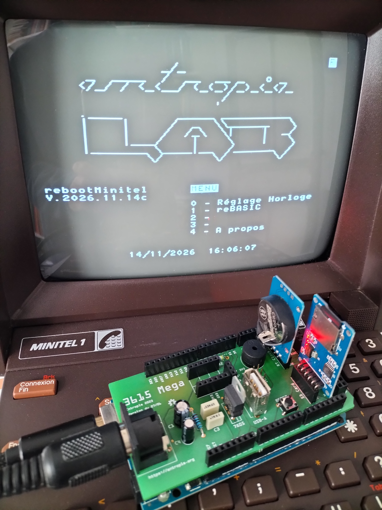
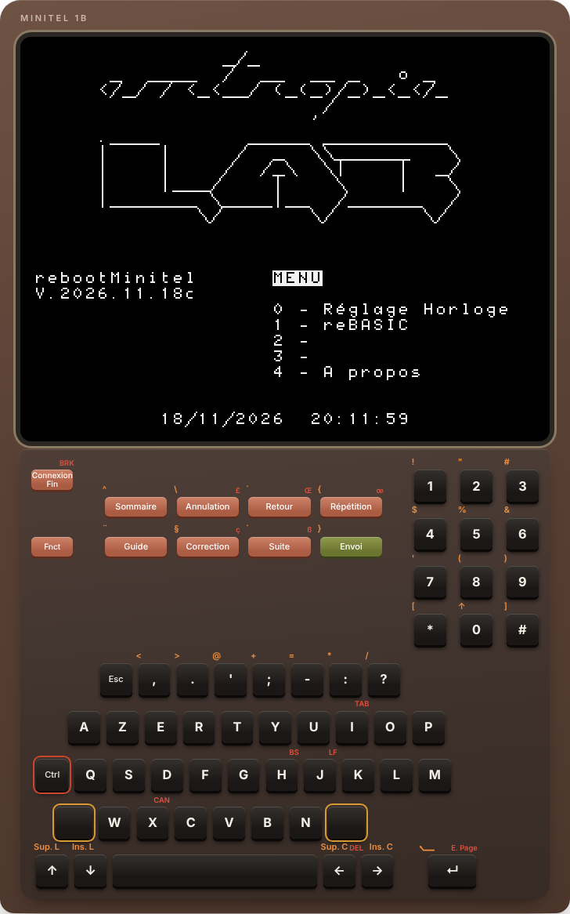

# rebootMinitel (version 2026.11.19d)

Redonner vie au Minitel 1B : un croquis et un shield Arduino qui transforment le Minitel en petit ordinateur autonome, avec une horloge et **reBASIC**, un interpréteur BASIC conçu pour l'écran et le clavier du Minitel.

Grâce à la **carte SD** du shield, reBASIC enregistre et recharge les programmes (`SAVE`, `LOAD`, `MERGE`), et chaque programme peut écrire et relire ses propres fichiers de données : scores, carnet d'adresses, journal de mesures… Ce sont de simples fichiers texte, que l'on peut aussi ouvrir sur un ordinateur, par exemple dans un tableur.

La carte peut aussi rester reliée à l'**ordinateur** par son câble USB : depuis le Minitel, `SAVE "PC:NOM"` enregistre alors le programme dans un dossier de l'ordinateur, et `LOAD "PC:NOM"` l'y reprend (voir [Programmes sur le PC](#programmes-sur-le-pc)). Une carte sans horloge (shield sans DS3231, ESP32 seul) y prend aussi l'heure.

reBASIC peut aussi piloter les **broches libres de l'Arduino** : allumer une LED ou un relais, faire varier une luminosité (MLI), lire un bouton ou un interrupteur, mesurer une tension sur une entrée analogique (potentiomètre, capteur de lumière ou de température…). Le Minitel devient ainsi l'écran et le clavier de petites expériences d'électronique (ou littéraires), programmées en BASIC.

Pas de Minitel sous la main ? Le **[Minitel virtuel](#minitel-virtuel)** fait tourner rebootMinitel et reBASIC dans un simple navigateur, sur l'écran et le clavier d'un Minitel 1B dessinés à l'identique. C'est le même reBASIC que sur la carte : on peut y écrire un programme, l'enregistrer sur l'ordinateur, puis le copier sur la carte SD du vrai Minitel, et inversement. Sa bibliothèque JavaScript `rebasic.js` permet aussi de mettre un Minitel qui exécute un programme reBASIC dans n'importe quelle page web.

Copyright 2023-2026 — Eric Sérandour — Logiciel libre sous licence [GNU GPLv3](LICENSE).
Site : <https://entropie.org/3615>



---

## Sommaire

- [Matériel](#matériel)
- [Bibliothèques](#bibliothèques)
- [Compilation](#compilation)
- [Utilisation](#utilisation)
  - [Pages Vidéotex (menu 2)](#pages-vidéotex-menu-2)
  - [Carte SD (menu 3)](#carte-sd-menu-3)
  - [Pong (menu 4)](#pong-menu-4)
- [Minitel virtuel](#minitel-virtuel)
- [reBASIC](#rebasic)
  - [Saisie et touches](#saisie-et-touches)
  - [Commandes](#commandes)
  - [Programmes sur le PC](#programmes-sur-le-pc)
  - [Instructions](#instructions)
  - [Attributs d'affichage](#attributs-daffichage)
  - [Fonctions](#fonctions)
  - [Variables et opérateurs](#variables-et-opérateurs)
  - [Dessin](#dessin)
  - [Fichiers de données](#fichiers-de-données)
  - [Broches de l'Arduino](#broches-de-larduino)
  - [Messages d'erreur](#messages-derreur)
  - [Limites](#limites)
  - [Exemples](#exemples)
- [Outils](#outils)

---

## Matériel

- Minitel 1B (liaison série par la prise péri-informatique DIN)
- Arduino Mega 2560 + **Shield 3615 Mega** (<https://entropie.org/3615/index.php/hardware-2023/>)
- Lecteur de carte microSD (Catalex), sur le bus SPI
- Horloge temps réel **DS3231**, sur le bus I2C
- Buzzer (avec une résistance de 470 Ω)

| Fonction | Broches (Arduino Mega) |
|---|---|
| Minitel | Serial1 : TX1 / RX1 (D18 / D19) |
| Liaison avec le PC (câble USB, passerelle) | Serial : D0 / D1 |
| Slot USB-A du shield | Serial2 : D16 / D17 |
| Buzzer | D2 |
| Horloge DS3231 | SDA / SCL (D20 / D21), SQW (D34), 32K (D36) |
| Carte SD | MISO D50, MOSI D51, SCK D52, CS D53 |

Le code prévoit aussi l'ESP32 (le Minitel est alors relié à `Serial2`).

## Bibliothèques

- [Minitel1B_Hard](https://github.com/eserandour/Minitel1B_Hard)
- [RTClib](https://github.com/adafruit/RTClib) (Adafruit)
- `SD` et `Wire` (fournies avec l'IDE Arduino)

## Compilation

Compilation réussie avec l'IDE Arduino 1.8.19, carte « Arduino Mega or Mega 2560 ».
Le dossier du croquis doit porter le même nom que le fichier `.ino` principal.

## Utilisation

Au démarrage, le croquis cherche la vitesse du Minitel puis la règle à 4800 bauds. Il vérifie ensuite l'horloge et la carte SD. Un message s'affiche si l'une d'elles est absente, mais le croquis continue sans elle.

Sans horloge DS3231, rebootMinitel garde l'heure avec une horloge logicielle : il prend l'**heure de l'ordinateur** si la [passerelle](outils/passerelle/README.md#lheure-du-pc) tourne (au démarrage, ou dès qu'elle est lancée, depuis l'écran d'accueil), et on peut aussi la régler à la main (menu 0). Elle perd l'heure quand la carte s'éteint.

Le menu d'accueil, qui affiche la date et l'heure, propose :

| Touche | Menu |
|---|---|
| `0` | Réglage de l'horloge (saisie JJ/MM/AAAA hh:mm, `CORRECTION` pour effacer, `SOMMAIRE` pour revenir sans modifier) ; sans horloge DS3231, règle l'horloge logicielle |
| `1` | reBASIC |
| `2` | Pages Vidéotex (voir ci-dessous) |
| `3` | Carte SD (voir ci-dessous) |
| `4` | Pong (voir ci-dessous) |
| `5` | À propos |

### Pages Vidéotex (menu 2)

Le menu 2 affiche les **pages Minitel** de la carte SD : les fichiers `.VDT` placés à la racine de la carte, par ordre alphabétique. Un premier écran donne le nombre de pages et les touches ; `SUITE` (ou `ENVOI`, pour le défilement automatique) affiche alors la première page. Ensuite, on ne voit que les pages : aucune explication n'est écrite par-dessus. Un fichier `.VDT` contient les octets d'une page Vidéotex, envoyés tels quels au Minitel. On en trouve en ligne, ou on les compose avec un éditeur comme [MiEdit](https://github.com/Zigazou/miedit). Le dossier [`exemples/`](exemples/) en contient deux (`DEMO1.VDT` et `DEMO2.VDT`).

| Touche | Effet |
|---|---|
| `SUITE` | Page suivante (après la dernière, on revient à la première) |
| `RETOUR` | Page précédente |
| `ENVOI` | Défilement automatique, une page toutes les 10 secondes (`VDT_DUREE` dans `Videotex.ino`), ou arrêt du défilement |
| `SOMMAIRE` | Retour au menu, même pendant l'affichage d'une page |


### Carte SD (menu 3)

Le menu 3 est un **gestionnaire de la carte SD** : il liste les fichiers de la racine de la carte par ordre alphabétique, avec leur taille, seize par écran (`SUITE` et `RETOUR` changent d'écran). Chaque fichier est repéré par une lettre, de `A` à `P` ; on tape la lettre pour le choisir, puis :

| Touche | Effet |
|---|---|
| `1` | **Afficher** : une page Vidéotex (`.VDT`) est dessinée ; un autre fichier (`.BAS`, `.TXT`…) est affiché comme du texte, écran par écran (`SUITE` pour la suite) |
| `2` | **Lancer** (programmes `.BAS`) : le programme est chargé dans reBASIC (`LOAD`), puis lancé (`RUN`). `SOMMAIRE` quitte ensuite reBASIC et revient au menu |
| `3` | **Supprimer**, après confirmation par `ENVOI` |
| `4` | **Copier sur le PC**, dans le dossier de la [passerelle](outils/passerelle/README.md#copier-des-fichiers-menu-3) (nom au format 8.3) |
| `SOMMAIRE` | Retour à la liste, puis au menu |

Depuis la liste, **`ENVOI` affiche les fichiers du PC** (le dossier de la passerelle), présentés de la même façon : on tape la lettre d'un fichier, puis `ENVOI` pour le **copier sur la carte SD** (un fichier de même nom sur la carte est remplacé, après un avertissement). Toutes sortes de fichiers passent, pages Vidéotex comprises. La copie se fait à la vitesse de la liaison USB (9600 bauds) : environ 2 secondes par kilo-octet.

### Pong (menu 4)

Le jeu de Pong, en semi-graphique : `0` Minitel contre Minitel (une démonstration qui ne s'arrête pas, jusqu'à `SOMMAIRE`), `1` un joueur contre le Minitel, `2` deux joueurs sur le même clavier. `A` et `Q` font monter et descendre la raquette de gauche, `P` et `M` celle de droite. Pendant le jeu, rien n'est écrit en bas de l'écran. Le premier à 5 points gagne : le gagnant s'affiche alors, centré en bas, avec `ENVOI` pour rejouer ; `SOMMAIRE` revient au menu. Le jeu dessine dans la mémoire de points de reBASIC : il n'utilise presque pas de mémoire vive en plus. Le clavier du Minitel n'envoie qu'une touche à la fois : à deux, les joueurs se partagent le clavier.

---

## Minitel virtuel

Le dossier [`outils/minitel-virtuel/`](outils/minitel-virtuel/) fait tourner rebootMinitel **dans un navigateur**, sans Minitel ni Arduino : ouvrez `index.html`. On y retrouve l'écran d'accueil (menu, date et heure, réglage de l'horloge, pages Vidéotex, carte SD, Pong, « À propos ») et reBASIC, sur l'écran d'un Minitel 1B dessiné avec sa police (les 128 caractères du processeur EF9345) et son clavier complet.



- **C'est le même reBASIC** : `rebasic.js` est un portage ligne à ligne de `Basic.ino` (mêmes instructions, mêmes messages d'erreur, mêmes limites que l'Arduino Mega ou l'ESP32, nombres en `float` 32 bits). Les caractères passent par la même table que Minitel1B_Hard, et l'écran suit les règles du STUM 1B. Le rythme aussi est celui de la carte : liaison à 4800 bauds, 1000 instructions par seconde.
- **Vérifié contre le simulateur** : `test/comparer.js` exécute tous les exemples du tutoriel dans les deux et compare les écrans case par case.
- **La carte SD** est gardée dans le navigateur ; les boutons « Ouvrir… » et « Enregistrer sous… » échangent les programmes avec l'ordinateur, au format de `SAVE` : un programme écrit dans la page peut être copié sur la carte microSD, et inversement.
- **Une bibliothèque JavaScript** : `rebasic.js` (un seul fichier, sans dépendance) permet de mettre un Minitel qui exécute un programme reBASIC dans n'importe quelle page web, par exemple pour présenter une œuvre.

Voir le [README du Minitel virtuel](outils/minitel-virtuel/README.md).

---

## reBASIC

Un petit interpréteur BASIC dans l'esprit des BASIC des années 80, adapté au Minitel : 40 colonnes, écran qui défile, touches de fonction, lettres accentuées, couleurs de fond, double taille, caractères semi-graphiques. Les programmes sont enregistrés sur la carte SD.

Il commande aussi les broches libres de l'Arduino : sorties numériques (`DWRITE`) et MLI (`AWRITE`), entrées numériques avec ou sans résistance de tirage (`DREAD`), entrées analogiques de 0 à 1023 (`AREAD`). Les broches utilisées par le Minitel, la carte SD, l'horloge et le buzzer sont protégées. Voir [Broches de l'Arduino](#broches-de-larduino).

Pour apprendre à programmer en reBASIC, pas à pas et avec de nombreux exemples : le tutoriel **[Programmer en reBASIC](Tutoriel_reBASIC.pdf)** (aussi en [ODT](Tutoriel_reBASIC.odt)).

```
reBASIC - 2048 octets libres
GUIDE : aide - SOMMAIRE : retour au menu
Ok
10 FOR I=1 TO 5
20 PRINT "Bonjour Minitel !"; I
30 NEXT
RUN
```

### Saisie et touches

- Une ligne qui commence par un **numéro** (1 à 65535) est rangée dans le programme. Un numéro seul supprime la ligne.
- Sans numéro, la ligne est **exécutée tout de suite** (mode direct).
- Plusieurs instructions peuvent se suivre sur une ligne, séparées par `:`.
- Les minuscules sont converties en majuscules, sauf entre guillemets.
- Une ligne fait au plus 78 caractères.

| Touche | Effet |
|---|---|
| `ENVOI` (ou Retour chariot) | Valide la ligne |
| `CORRECTION` | Efface le dernier caractère |
| `ANNULATION` | Abandonne la ligne en cours / interrompt le programme |
| `GUIDE` | Affiche l'aide (4 pages : `SUITE` et `RETOUR` pour changer de page, `ENVOI` pour revenir à reBASIC) |
| `SOMMAIRE` | Interrompt le programme / revient au menu (le programme en mémoire est conservé) |

### Commandes

| Commande | Rôle |
|---|---|
| `RUN` | Lance le programme (efface d'abord les variables) |
| `EDIT n` | Réaffiche la ligne n dans la zone de saisie, pour la corriger : `CORRECTION` efface la fin, `ENVOI` valide, `ANNULATION` abandonne |
| `LIST [début][-fin] [/P]` | Affiche le programme, ou une partie : `LIST 100`, `LIST 100-200`, `LIST -50`, `LIST 300-`. Avec `/P`, la liste s'arrête à chaque écran plein : `SUITE` continue, `ANNULATION` arrête (`LIST /P`, `LIST 100-500 /P`) |
| `NEW` | Efface le programme et les variables |
| `MEM` | Affiche la mémoire libre pour le programme |
| `RENUM [début][,pas]` | Renumérote le programme (10,10 par défaut) |
| `AIDE` (ou `HELP`) | Affiche l'aide, comme la touche `GUIDE` |
| `SAVE "NOM"` | Enregistre le programme dans `NOM.BAS` sur la carte SD |
| `LOAD "NOM"` | Charge `NOM.BAS` (remplace le programme en cours) |
| `MERGE "NOM"` | Ajoute les lignes de `NOM.BAS` au programme en cours (une ligne de même numéro est remplacée) |
| `FILES` | Liste les fichiers de la carte SD par ordre alphabétique, avec leur taille (les programmes sans leur extension `.BAS`) |
| `KILL "NOM"` | Supprime `NOM.BAS` (ou le fichier nommé, s'il a une extension : `KILL "DONNEES.TXT"`) |
| `SAVE "PC:NOM"`, `LOAD "PC:NOM"`, `MERGE "PC:NOM"`, `FILES "PC:"` | Les mêmes, avec un dossier de l'ordinateur à la place de la carte SD (voir [Programmes sur le PC](#programmes-sur-le-pc)) |

Les noms de fichiers suivent le format 8.3 : 1 à 8 lettres, chiffres, `_` ou `-`, et une extension facultative de 1 à 3 caractères.

### Programmes sur le PC

Avec le préfixe `PC:`, les programmes sont enregistrés et chargés **dans un dossier de l'ordinateur**, relié à la carte par son câble USB, sans passer par la carte SD :

```
SAVE "PC:JEU"      enregistre le programme dans JEU.BAS, sur l'ordinateur
LOAD "PC:JEU"      charge JEU.BAS depuis l'ordinateur
MERGE "PC:JEU"     ajoute les lignes de JEU.BAS au programme en cours
FILES "PC:"        liste les fichiers du dossier de l'ordinateur
```

Sur l'ordinateur, il faut lancer la passerelle [`outils/passerelle/passerelle.py`](outils/passerelle/) (Python 3 et pyserial), en lui donnant le dossier des programmes :

```
python3 outils/passerelle/passerelle.py --dossier ~/Documents/reBASIC
```

Les fichiers ont le même format que sur la carte SD : on peut les écrire dans un éditeur de texte, ou les ouvrir dans le Minitel virtuel. La passerelle donne aussi l'heure à une carte sans horloge DS3231. Sans réponse de la passerelle, reBASIC affiche `PC absent`. L'Arduino Mega redémarre quand la passerelle ouvre le port : lancez-la avant de taper un programme. Voir le [README de la passerelle](outils/passerelle/README.md).

`RENUM` met aussi à jour les numéros de ligne écrits après `GOTO`, `GOSUB`, `THEN`, `ELSE`, `RESTORE` et dans les listes de `ON … GOTO/GOSUB`. Les chaînes et les commentaires ne sont pas modifiés. Un numéro calculé (`GOTO 100+X`) ne peut pas être mis à jour. Si la place manque, rien n'est changé.

### Instructions

**Affichage et saisie**

| Instruction | Rôle |
|---|---|
| `PRINT` (ou `?`) | Affiche des nombres et des chaînes. `;` colle les éléments, `,` passe à la colonne suivante (multiple de 10), `TAB(n)` va à la colonne n. Un `;` ou une `,` en fin de ligne évite le retour à la ligne. |
| `INPUT ["texte";] v[,v…]` | Demande une ou plusieurs valeurs au clavier |
| `CLS` | Efface l'écran (et le dessin), et revient à l'affichage normal |
| `LOCATE colonne,rangée` | Place le curseur (colonne 1 à 40, rangée 1 à 24) |

Couleurs, fond, inversion, clignotement, soulignement et taille : voir [Attributs d'affichage](#attributs-daffichage).

**Variables et contrôle**

| Instruction | Rôle |
|---|---|
| `[LET] v = expression` | Affectation (`LET` est facultatif) |
| `IF condition THEN … [ELSE …]` | Après `THEN` et `ELSE` : un numéro de ligne ou des instructions. `IF … GOTO n` est accepté. Chaque `IF` imbriqué sur une même ligne a son propre `ELSE`. |
| `GOTO n` | Saut à la ligne n |
| `GOSUB n` / `RETURN` | Appel de sous-programme / retour (12 niveaux) |
| `ON x GOTO n1,n2…` | Saut à la x-ième ligne de la liste (instruction suivante si x est hors de la liste) |
| `ON x GOSUB n1,n2…` | Pareil, en sous-programme |
| `FOR v = a TO b [STEP c]` / `NEXT [v]` | Boucle (8 niveaux) |
| `WHILE condition` / `WEND` | Boucle tant que la condition est vraie (6 niveaux) |
| `DATA valeur,valeur…` | Données du programme : nombres, chaînes avec ou sans guillemets (sans guillemets, elles passent en majuscules) |
| `READ v[,v…]` | Lit les données suivantes des lignes `DATA` |
| `RESTORE [n]` | Repart du premier `DATA` du programme, ou de la ligne n |
| `DIM A(n)` | Tableau A d'indices 0 à n. Sans `DIM`, un tableau a les indices 0 à 10. |
| `REM …` ou `' …` | Commentaire jusqu'à la fin de la ligne |
| `END` | Fin du programme |
| `STOP` | Arrête le programme |

**Son et attente**

| Instruction | Rôle |
|---|---|
| `BEEP` | Bip du Minitel |
| `SOUND fréquence,durée` | Son sur le buzzer (31 à 20000 Hz, durée en ms) |
| `PAUSE durée` | Attente en millisecondes (`ANNULATION` interrompt aussi le programme pendant l'attente) |

**Dessin** : `PLOT` et `LINE`, voir [Dessin](#dessin).
**Fichiers** : `OPEN`, `CLOSE`, `PRINT #`, `INPUT #`, `LINE INPUT #`, voir [Fichiers de données](#fichiers-de-données).
**Broches** : `PINMODE`, `DWRITE`, `AWRITE`, voir [Broches de l'Arduino](#broches-de-larduino).

### Attributs d'affichage

Les couleurs vont de 0 à 7 : 0 noir, 1 rouge, 2 vert, 3 jaune, 4 bleu, 5 magenta, 6 cyan, 7 blanc. Sur le Minitel 1B, dont l'écran est monochrome, elles apparaissent en niveaux de gris.

| Instruction | Rôle |
|---|---|
| `COLOR n` | Couleur des caractères et des points |
| `PAPER n` | Couleur de fond (voir ci-dessous) |
| `INVERSE n` | Vidéo inverse (1) ou normale (0) |
| `FLASH n` | Clignotement (1) ou texte fixe (0) |
| `UNDERLINE n` | Soulignement (1) ou non (0) |
| `SIZE n` | Taille : 0 normale, 1 double hauteur, 2 double largeur, 3 double taille |

Ces instructions suivent les règles du Minitel (STUM 1B, partie 2, chapitre 2) :

- **`PAPER` et `UNDERLINE` sont des attributs de zone.** En texte, ils ne prennent effet qu'au **premier espace** écrit ensuite (`PAPER 4: PRINT " Titre"`), puis valent pour tout ce qui est écrit sur la même rangée. Sur la rangée suivante, le fond redevient noir jusqu'au premier espace, qui remet la couleur de `PAPER` : revenez à `PAPER 0` quand vous n'en avez plus besoin. En dessin, chaque case semi-graphique prend aussitôt le fond en cours : une case a donc deux couleurs, `COLOR` pour les points et `PAPER` pour le fond.
- **Double hauteur et double taille** : `SIZE 1` ou `SIZE 3` descend le curseur d'une rangée, et le texte occupe la rangée de départ et la suivante. Elles sont sans effet sur la rangée 1.
- **Double largeur** : chaque caractère occupe deux colonnes.
- Le semi-graphique annule la taille, l'inversion et le soulignement du Minitel : reBASIC les rétablit après chaque dessin.
- `CLS`, la fin du programme et les messages d'erreur reviennent à l'affichage normal.

La une de **Minitel Matin** (`exemples/MATIN.BAS`) les utilise tous : un bandeau en vidéo inverse, un gros titre en double taille, un sous-titre en double largeur, une rubrique soulignée, des couleurs (en gris sur le Minitel 1B), une alerte sur fond bleu et une dernière minute qui clignote.

```basic
10 CLS: INVERSE 1: PRINT " MINITEL MATIN"; TAB(40): INVERSE 0
20 LOCATE 11, 4: SIZE 3: PRINT "IL NEIGE !": SIZE 0
30 LOCATE 14, 7: SIZE 2: PRINT "Partout": SIZE 0
40 LOCATE 1, 10: UNDERLINE 1: PRINT " La météo du jour": UNDERLINE 0
50 PRINT: COLOR 6: PRINT " Matin : -3°C"
60 COLOR 3: PRINT " Après-midi : 1°C": COLOR 7
70 LOCATE 1, 16: PAPER 4: PRINT " Routes glissantes"; TAB(40)
80 PAPER 0: LOCATE 13, 20: FLASH 1: PRINT "DERNIERE MINUTE": FLASH 0
90 GOTO 90
```

- La rubrique (ligne 40) et l'alerte (ligne 70) commencent par un espace : le soulignement et le fond sont des attributs de zone, qui ne prennent effet qu'au premier espace. La vidéo inverse (ligne 10), elle, s'applique tout de suite.
- `TAB(40)` prolonge le bandeau et l'alerte jusqu'à la 39e colonne (reBASIC n'écrit pas dans la dernière, pour ne pas passer à la rangée suivante).
- `SIZE 3` (ligne 20) descend le curseur d'une rangée : « IL NEIGE ! » occupe les rangées 4 et 5. En double largeur (ligne 30), « Partout » occupe 14 colonnes : les titres sont centrés en conséquence.
- La ligne 90 garde la page à l'écran ; `ANNULATION` l'arrête.

### Fonctions

**Fonctions numériques**

| Fonction | Résultat |
|---|---|
| `ABS(x)` `INT(x)` `SGN(x)` `SQR(x)` | Valeur absolue, partie entière, signe, racine carrée |
| `SIN(x)` `COS(x)` `TAN(x)` `ATN(x)` | Trigonométrie (angles en radians) |
| `LOG(x)` `EXP(x)` | Logarithme népérien, exponentielle |
| `RND(n)` | Nombre de 0 à 1 si n ≤ 1, entier de 1 à n sinon |
| `LEN(a$)` | Nombre de caractères |
| `VAL(a$)` | Valeur du nombre écrit dans a$ |
| `ASC(a$)` | Code du premier caractère |
| `INSTR([début,]a$,b$)` | Position de b$ dans a$ (0 si absente) |
| `POINT(x,y)` | -1 si le point est allumé, 0 sinon |
| `TIMER` | Millisecondes écoulées depuis le `RUN` |
| `HOUR` `MINUTE` `SECOND` | Heure, minutes, secondes (horloge RTC, ou heure du PC) |
| `DAY` `MONTH` `YEAR` | Jour, mois, année (horloge RTC, ou heure du PC) |
| `EOF(n)` | -1 à la fin du fichier n, 0 sinon |
| `DREAD(broche)` | État d'une broche numérique : 0 ou 1 |
| `AREAD(entrée)` | Entrée analogique : 0 à 1023 |
| `KEY` | Code de la touche frappée, sans attendre (0 si aucune), touches de fonction comprises (voir ci-dessous) |

**Fonctions de chaînes**

| Fonction | Résultat |
|---|---|
| `CHR$(n)` | Caractère de code n (1 à 127). Les codes de contrôle sont envoyés tels quels au Minitel : `PRINT CHR$(17);` affiche le curseur, `PRINT CHR$(20);` le cache. |
| `STR$(x)` | Le nombre x écrit en chaîne |
| `HEX$(n)` | Le nombre n en hexadécimal |
| `LEFT$(a$,n)` `RIGHT$(a$,n)` | Les n premiers / derniers caractères |
| `MID$(a$,début[,n])` | n caractères à partir de début (jusqu'à la fin sans n) |
| `UPPER$(a$)` `LOWER$(a$)` | Majuscules / minuscules (lettres sans accent seulement) |
| `INKEY$` | Touche frappée, sans attendre (chaîne vide si aucune) |
| `TIME$` | Heure, « hh:mm:ss » |
| `DATE$` | Date, « JJ/MM/AAAA » |

**Codes donnés par `KEY`**

`INKEY$` ne donne que des caractères : les touches de fonction du Minitel n'en ont pas. `KEY` donne le code de toutes les touches, tel que le transmet le Minitel :

| Touche | Code | | Touche | Code |
|---|---|---|---|---|
| ENVOI | 4929 | | GUIDE | 4932 |
| RETOUR | 4930 | | CORRECTION | 4935 |
| REPETITION | 4931 | | SUITE | 4936 |

Pour les autres touches, `KEY` donne le code (Unicode) du caractère : `A` 65, `a` 97, `é` 233… ANNULATION et SOMMAIRE ne sont pas transmises : elles arrêtent le programme, comme toujours. `KEY` et `INKEY$` lisent le même clavier : une touche lue par l'un n'est plus disponible pour l'autre.

```basic
10 K = KEY: IF K = 0 THEN 10
20 IF K = 4936 THEN PRINT "SUITE" ELSE PRINT "Code "; K
30 GOTO 10
```

### Variables et opérateurs

| Type | Noms |
|---|---|
| Nombres (environ 7 chiffres significatifs) | `A` à `Z` |
| Chaînes (32 caractères au plus sur le Mega, 78 sur l'ESP32) | `A$` à `Z$` |
| Tableaux de nombres | `A(n)` à `Z(n)` |

| Opérateurs | |
|---|---|
| Calcul | `+` `-` `*` `/` `^` (touche flèche vers le haut) `MOD` |
| Comparaison | `=` `<>` `<` `>` `<=` `>=` (sur des nombres ou des chaînes) |
| Logique | `AND` `OR` `NOT` (vrai vaut -1, faux vaut 0) |
| Chaînes | `+` pour coller deux chaînes |

### Dessin

L'écran est une grille de **80 × 72 points** (x de 0 à 79, y de 0 à 71, origine en haut à gauche), obtenue avec les caractères semi-graphiques du Minitel : chaque case de texte contient 2 × 3 points.

| Instruction | Rôle |
|---|---|
| `PLOT x,y[,c]` | Allume un point (l'éteint si c = 0) |
| `LINE x1,y1,x2,y2[,c]` | Trace un segment (l'efface si c = 0) |
| `BOX x1,y1,x2,y2[,c[,p]]` | Trace un rectangle (l'efface si c = 0 ; plein si p = 1) |
| `CIRCLE x,y,r[,c[,p]]` | Trace un cercle de centre (x,y) et de rayon r (l'efface si c = 0 ; plein si p = 1) |
| `POINT(x,y)` | -1 si le point est allumé |

- Les points du Minitel sont 1,25 fois plus larges que hauts (matrice de 8 × 10 découpée en 2 × 3). Le rayon de `CIRCLE` est donc mesuré horizontalement, et le cercle s'étend sur r × 1,25 points verticalement, pour paraître rond.
- La couleur des points est celle fixée par `COLOR`, le fond de la case celui fixé par `PAPER`. Une case n'a qu'une couleur de points et une couleur de fond : un nouveau tracé dans une case lui donne les couleurs en cours. Pour peindre une grande surface, effacez un rectangle plein avec le fond voulu : `PAPER 4: BOX 0,0,79,35,0,1`.
- `CLS` efface le dessin.
- Les points sont gardés en mémoire pour pouvoir en allumer plusieurs dans une même case. Cette mémoire ne suit pas le défilement de l'écran : mieux vaut dessiner après un `CLS` et placer le texte avec `LOCATE`.
- La case en bas à droite n'est pas dessinée, car y écrire ferait défiler l'écran.

### Fichiers de données

Des fichiers texte sur la carte SD (extension `.TXT` par défaut), deux ouverts au plus en même temps.

| Instruction | Rôle |
|---|---|
| `OPEN "NOM" FOR INPUT AS #n` | Ouvre un fichier en lecture (n = 1 ou 2) |
| `OPEN "NOM" FOR OUTPUT AS #n` | Crée un fichier (le remplace s'il existe) |
| `OPEN "NOM" FOR APPEND AS #n` | Ouvre un fichier pour écrire à la suite |
| `PRINT #n, …` | Écrit dans le fichier, comme `PRINT` |
| `INPUT #n, v[,v…]` | Lit des valeurs |
| `LINE INPUT #n, A$` | Lit une ligne entière |
| `EOF(n)` | -1 à la fin du fichier |
| `CLOSE [#n[,#m]]` | Ferme un fichier, ou tous sans paramètre |

- Avec `PRINT #`, la virgule écrit une virgule dans le fichier : `PRINT #1, A, B$` écrit par exemple `12,TEXTE`.
- `INPUT #` lit des valeurs séparées par des virgules ou des fins de ligne. Une valeur entre guillemets peut contenir des virgules.
- Les fichiers sont fermés automatiquement par `RUN`, `NEW`, `LOAD`, quand le programme s'arrête (fin, `END`, `STOP`, erreur, interruption) et en quittant reBASIC.

### Broches de l'Arduino

| Instruction / fonction | Rôle |
|---|---|
| `PINMODE broche,mode` | 0 entrée, 1 sortie, 2 entrée avec résistance de tirage interne (bouton vers GND : appuyé = 0) |
| `DWRITE broche,valeur` | Sortie numérique : 0 ou 1 |
| `AWRITE broche,valeur` | Sortie MLI (PWM) : 0 à 255 |
| `DREAD(broche)` | Lecture numérique : 0 ou 1 |
| `AREAD(entrée)` | Lecture analogique : 0 à 1023 (entrée A0 à A15 sur le Mega, numéro de broche sur l'ESP32) |

Le mode 2 (`INPUT_PULLUP` de l'Arduino) relie la broche au +5 V par une résistance interne. Un bouton se branche alors simplement entre la broche et GND : `DREAD` renvoie 1 quand il est relâché et 0 quand il est appuyé (logique inversée). En mode 0, une entrée reliée à rien donne un état imprévisible.

```basic
10 PINMODE 7,2
20 IF DREAD(7)=0 THEN PRINT "Appuyé" ELSE PRINT "Relâché"
30 PAUSE 200: GOTO 20
```

Les broches utilisées par le Minitel, la carte SD, l'horloge, le buzzer et les liaisons série sont refusées (erreur « Broche interdite »).

### Messages d'erreur

En cas d'erreur, reBASIC donne le message et le numéro de la ligne, puis réaffiche la ligne avec, **en vidéo inverse, l'endroit où l'analyse s'est arrêtée** :

```
Erreur de syntaxe en ligne 10
10 PRINT 1+*2          (le * apparaît en vidéo inverse)
```

| Message | Cause |
|---|---|
| Erreur de syntaxe | Instruction mal écrite |
| Division par zéro | |
| Ligne n inexistante | `GOTO`, `GOSUB`, `RESTORE`… vers une ligne qui n'existe pas |
| RETURN sans GOSUB / NEXT sans FOR / WEND sans WHILE / WHILE sans WEND | Structures mal appariées |
| Mémoire pleine | Programme ou tableaux trop grands |
| Ligne trop longue | `EDIT` d'une ligne de plus de 78 caractères (possible après un `RENUM`) |
| Type incompatible | Nombre à la place d'une chaîne, ou l'inverse |
| Indice hors limites | Indice de tableau en dehors de 0 à n |
| Trop d'imbrications | Trop de parenthèses, `GOSUB`, `FOR` ou `WHILE` imbriqués |
| Valeur incorrecte | Paramètre hors des limites permises |
| Plus de DATA | `READ` après la dernière donnée |
| Fichier introuvable / Fichier déjà ouvert / Fichier non ouvert / Fin de fichier / Erreur de fichier | Fichiers sur la carte SD (ou sur le PC) |
| PC absent | `SAVE "PC:…"`, `LOAD "PC:…"`… sans réponse de la passerelle sur l'ordinateur |
| Broche interdite | Broche réservée au matériel |
| Horloge absente | Fonction d'heure ou de date sans horloge RTC, sans heure réglée à la main et sans réponse de la passerelle |
| Interruption | `ANNULATION` ou `SOMMAIRE` pendant l'exécution |

### Limites

| | Arduino Mega | ESP32 |
|---|---|---|
| Taille du programme | 2 048 octets | 16 384 octets |
| Longueur des chaînes | 32 caractères | 78 caractères |
| Éléments de tableaux (au total) | 64 | 1 000 |
| Parenthèses et fonctions imbriquées | 6 niveaux | 8 niveaux |

Ces tailles se règlent au début de `Basic.ino` (`BAS_PROG_SIZE`, `BAS_STR_MAX`, `BAS_ARR_SIZE`…), selon la mémoire disponible.

- `TIMER` perd de la précision après environ 4 h 30 (nombres sur 7 chiffres significatifs).
- Une boucle `WHILE` sans `WEND` n'est signalée que si sa condition est fausse.

### Exemples

Le dossier [`exemples/`](exemples/) contient dix programmes et deux pages Vidéotex (`DEMO1.VDT` et `DEMO2.VDT`, pour le [menu 2](#pages-vidéotex-menu-2)). Les programmes sont enregistrés au format de `SAVE` : on peut les copier sur la carte microSD et les charger avec `LOAD "BALLE"`, les ouvrir dans le [Minitel virtuel](#minitel-virtuel) (bouton « Ouvrir… », ou directement dans sa liste), ou les lancer dans le [simulateur](outils/simulateur/). Ils viennent presque tous du tutoriel, qui les explique en détail ; « Minitel Matin » illustre les [attributs d'affichage](#attributs-daffichage).

| Fichier | Programme |
|---|---|
| [`BALLE.BAS`](exemples/BALLE.BAS) | **La balle qui rebondit** — Une balle rebondit dans un rectangle fermé : on l'efface, on la déplace, on la redessine. |
| [`CERCLES.BAS`](exemples/CERCLES.BAS) | **Cercles** — Rectangles et cercles, vides et pleins (`BOX`, `CIRCLE`). |
| [`HORLOGE.BAS`](exemples/HORLOGE.BAS) | **L'horloge** — La date et l'heure, centrées sur l'écran et mises à jour en permanence. |
| [`LUNE.BAS`](exemples/LUNE.BAS) | **Au clair de la lune** — Une mélodie rangée dans des `DATA`, jouée sur le buzzer avec `SOUND`. |
| [`MAISON.BAS`](exemples/MAISON.BAS) | **La maison** — Un dessin en couleurs : ciel, herbe, soleil, maison et porte (gris sur le Minitel 1B). |
| [`MATIN.BAS`](exemples/MATIN.BAS) | **Minitel Matin** — La une d'un journal : vidéo inverse, double taille, double largeur, soulignement, couleurs, fond et clignotement. |
| [`MYSTERE.BAS`](exemples/MYSTERE.BAS) | **Le nombre mystère** — Trouver un nombre entre 1 et 100 : « C'est plus », « C'est moins ». |
| [`PAGES.BAS`](exemples/PAGES.BAS) | **Pages SUITE / RETOUR** — Des pages que l'on feuillette comme sur un service Minitel, avec `KEY`. |
| [`PENDU.BAS`](exemples/PENDU.BAS) | **Le pendu** — Le jeu du pendu, avec ses mots dans des `DATA`. |
| [`SERPENT.BAS`](exemples/SERPENT.BAS) | **Le serpent** — Un serpent avance au hasard et s'arrête quand il se touche : `POINT` lit l'écran. |

**La balle qui rebondit** (`BALLE.BAS`)

```basic
10 CLS: X = 5: Y = 5: U = 1: V = 1
20 BOX 0, 0, 79, 68
30 PLOT X, Y, 0
40 X = X + U: Y = Y + V
50 IF X <= 1 OR X >= 78 THEN U = -U
60 IF Y <= 1 OR Y >= 67 THEN V = -V
70 PLOT X, Y
80 GOTO 30
```

**Cercles** (`CERCLES.BAS`)

```basic
10 CLS
20 BOX 2, 3, 30, 30
30 BOX 8, 9, 24, 24, 1, 1
40 CIRCLE 56, 18, 13
50 CIRCLE 56, 18, 5, 1, 1
60 BOX 40, 46, 76, 69
70 CIRCLE 50, 57, 6: CIRCLE 66, 57, 6, 1, 1
80 GOTO 80
```

**L'horloge** (`HORLOGE.BAS`)

```basic
10 CLS: LOCATE 16, 11: PRINT DATE$
20 LOCATE 17, 13: PRINT TIME$;
30 PAUSE 200: GOTO 20
```

**Au clair de la lune** (`LUNE.BAS`)

```basic
10 REM Au clair de la lune
20 READ F, D
30 IF F = 0 THEN END
40 SOUND F, D: PAUSE 30
50 GOTO 20
100 DATA 262,400,262,400,262,400,294,400
110 DATA 330,800,294,800,262,400,330,400
120 DATA 294,400,294,400,262,1200,0,0
```

**La maison** (`MAISON.BAS`)

```basic
10 CLS
20 PAPER 4: BOX 0, 0, 79, 44, 0, 1
30 PAPER 2: BOX 0, 45, 79, 71, 0, 1
40 COLOR 3: PAPER 4: CIRCLE 62, 14, 7, 1, 1
50 COLOR 7: PAPER 2: BOX 12, 33, 35, 62, 1, 1
60 COLOR 1: BOX 20, 45, 27, 62, 1, 1
70 GOTO 70
```

**Minitel Matin** (`MATIN.BAS`)

```basic
10 CLS: INVERSE 1: PRINT " MINITEL MATIN"; TAB(40): INVERSE 0
20 LOCATE 11, 4: SIZE 3: PRINT "IL NEIGE !": SIZE 0
30 LOCATE 14, 7: SIZE 2: PRINT "Partout": SIZE 0
40 LOCATE 1, 10: UNDERLINE 1: PRINT " La météo du jour": UNDERLINE 0
50 PRINT: COLOR 6: PRINT " Matin : -3°C"
60 COLOR 3: PRINT " Après-midi : 1°C": COLOR 7
70 LOCATE 1, 16: PAPER 4: PRINT " Routes glissantes"; TAB(40)
80 PAPER 0: LOCATE 13, 20: FLASH 1: PRINT "DERNIERE MINUTE": FLASH 0
90 GOTO 90
```

**Le nombre mystère** (`MYSTERE.BAS`)

```basic
10 CLS: PRINT "J'ai choisi un nombre"
15 PRINT "entre 1 et 100."
20 M = RND(100): C = 0
30 INPUT "Ta proposition"; P
40 C = C + 1
50 IF P < M THEN PRINT "C'est plus.": GOTO 30
60 IF P > M THEN PRINT "C'est moins.": GOTO 30
70 PRINT "Gagné en "; C; " coups !"
```

**Pages SUITE / RETOUR** (`PAGES.BAS`)

```basic
10 P = 1
20 CLS: PRINT "Page "; P; " sur 3"
30 PRINT: PRINT "SUITE : page suivante"
40 PRINT "RETOUR : page précédente"
50 PRINT "ENVOI : fin"
60 K = KEY: IF K = 0 THEN 60
70 IF K = 4936 AND P < 3 THEN P = P + 1: GOTO 20
80 IF K = 4930 AND P > 1 THEN P = P - 1: GOTO 20
90 IF K <> 4929 THEN 60
100 CLS: PRINT "Au revoir"
```

**Le pendu** (`PENDU.BAS`)

```basic
10 CLS: RESTORE: N = RND(5)
20 FOR I = 1 TO N: READ M$: NEXT
30 L = LEN(M$): T$ = "": E = 0
40 FOR I = 1 TO L: T$ = T$ + "-": NEXT
50 PRINT: PRINT T$; "   erreurs : "; E; "/7"
60 IF T$ = M$ THEN PRINT "Gagné !": END
70 IF E = 7 THEN PRINT "Perdu, c'était "; M$: END
80 INPUT "Lettre"; C$: C$ = UPPER$(LEFT$(C$, 1))
90 IF INSTR(M$, C$) = 0 THEN E = E + 1: GOTO 50
100 FOR I = 1 TO L
110 IF MID$(M$, I, 1) = C$ THEN GOSUB 200
120 NEXT: GOTO 50
200 T$ = LEFT$(T$, I - 1) + C$ + MID$(T$, I + 1): RETURN
300 DATA MINITEL, ARDUINO, CLAVIER, MODEM, ECRAN
```

**Le serpent** (`SERPENT.BAS`)

```basic
10 CLS: X = 40: Y = 36: U = 1: V = 0: N = 0
20 R = RND(8)
30 IF R = 1 THEN W = U: U = V: V = -W
40 IF R = 2 THEN W = U: U = -V: V = W
50 X = X + U: Y = Y + V
60 IF X < 0 OR X > 79 OR Y < 0 OR Y > 70 THEN 90
70 IF POINT(X, Y) THEN 90
80 PLOT X, Y: N = N + 1: GOTO 20
90 LOCATE 1, 1: PRINT N; " pas.";
100 GOTO 100
```

---

## Outils

Le dossier [`outils/`](outils/) contient, pour l'ordinateur :

- le **Minitel virtuel** : rebootMinitel et reBASIC dans un navigateur, et la bibliothèque JavaScript `rebasic.js` (voir [Minitel virtuel](#minitel-virtuel)) ;
- la **passerelle** avec le PC : enregistrer et ouvrir des programmes sur l'ordinateur depuis le Minitel (voir [Programmes sur le PC](#programmes-sur-le-pc)) ;
- un **simulateur** de reBASIC, qui compile le vrai `Basic.ino` sur PC : exécuter un programme, utiliser reBASIC dans un terminal, produire des images d'écran ;
- la **fabrication du tutoriel** « Programmer en reBASIC » (ODT et PDF), dont tous les exemples sont exécutés dans le simulateur.
