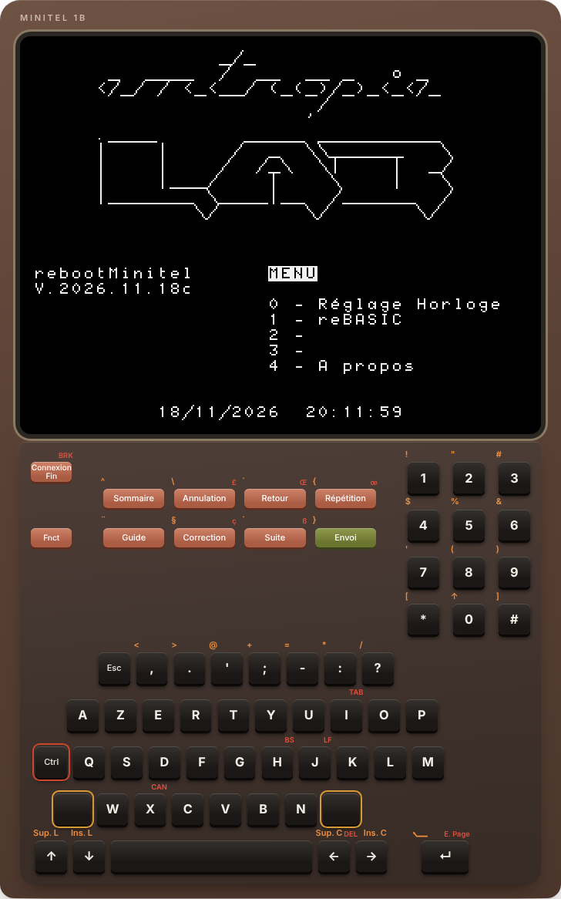

# Minitel virtuel — rebootMinitel et reBASIC dans un navigateur



Ouvrez **`index.html`** dans un navigateur : rebootMinitel démarre sur son écran d'accueil (menu, date et heure), comme sur la carte. Tapez **1** pour entrer dans reBASIC, au clavier de l'ordinateur ou sur celui du Minitel 1B dessiné sous l'écran. La liste à droite contient les programmes du dossier [`exemples/`](../../exemples/) ; « Ouvrir… » et « Enregistrer sous… » échangent les programmes avec l'ordinateur. « Ouvrir… » accepte aussi les pages Vidéotex (`.VDT`) : elles vont sur la carte SD, et le menu **2** les affiche (`SUITE`, `RETOUR`, `ENVOI` pour le défilement automatique). Les deux pages du dossier `exemples/` y sont déjà. Le menu **3** gère la carte SD du navigateur : afficher, lancer ou supprimer un fichier.

| Fichier | Rôle |
|---|---|
| `index.html` | la page : le Minitel, les exemples, l'éditeur de programme et les réglages |
| `rebasic.js` | la bibliothèque : l'écran, le clavier, rebootMinitel et reBASIC |
| `test/comparer.js` | compare `rebasic.js` au simulateur C (voir [Tests](#tests)) |
| `test/ascii.py` | remplace les caractères non ASCII des chaînes de `rebasic.js` par des `\uXXXX` (à relancer après une modification) |

## La bibliothèque rebasic.js

`rebasic.js` fait tourner **reBASIC**, le BASIC de [rebootMinitel](https://github.com/eserandour/rebootMinitel), dans un navigateur, sur l'écran d'un Minitel virtuel. Un seul fichier, sans dépendance : il suffit de le copier à côté d'une page web pour y mettre un Minitel.

- **L'interpréteur** est un portage ligne à ligne de `Basic.ino` : mêmes instructions, mêmes messages d'erreur (avec la vidéo inverse à l'endroit fautif), mêmes limites que l'Arduino Mega (programme de 2048 octets, chaînes de 32 octets, 64 cases de tableaux…), nombres en `float` 32 bits comme sur l'ATmega.
- **L'écran** reçoit le même flux Videotex que le vrai Minitel (codes de commande, attributs ESC, US, SS2 pour les accents, semi-graphiques) et l'interprète avec les règles du STUM 1B : attributs de zone validés par un espace, double hauteur dessinée vers le haut et sans effet sur la rangée 1, semi-graphique qui annule taille, inversion et soulignement, mode rouleau.
- **La police** est celle du Minitel : les 128 caractères du jeu G0 du processeur EF9345, matrice de 8 × 10 points (relevés par Frédéric Bisson pour [MiEdit](https://github.com/Zigazou/miedit)), dessinés point par point, sans lissage, en taille normale comme en double hauteur, largeur ou taille. Les lettres ä, ë, î, ö et ü, qui n'ont pas de dessin propre, s'affichent sans leur tréma ou leur accent.
- **Les caractères** passent par la même table de conversion que `print()` dans Minitel1B_Hard : lettres accentuées minuscules, £ ° ± ¼ ½ ¾ § ÷ Œ œ ← ↑ → ↓ —. Le Minitel n'a pas de majuscules accentuées : « À », « É »… s'affichent « A », « E »… (c'est pourquoi le menu affiche « A propos »). Un caractère inconnu du Minitel n'est pas affiché.
- **Le rythme** est celui de la machine : les octets arrivent à 4800 bauds (l'Arduino attend que son tampon série de 64 octets se vide), et l'interpréteur exécute 1000 instructions par seconde, comme le simulateur de rebootMinitel. Les deux réglages sont modifiables.

Vérifié contre le simulateur C officiel (`outils/simulateur`) : sur les 117 écrans du tutoriel et des tests ajoutés, 107 sont identiques case par case (caractère, couleur, fond, inversion, soulignement, clignotement, taille, points). Les autres ne diffèrent que par les tirages de `RND` et par l'ordre des fichiers de `FILES`.

## En deux lignes

```html
<div id="minitel"></div>
<script src="rebasic.js"></script>
<script>
  const minitel = ReBASIC.creer(document.getElementById('minitel'));
</script>
```

L'écran d'accueil de rebootMinitel s'affiche, comme sur la carte : le logo entropie LAB, la version, le menu, et la date et l'heure en bas de l'écran, mises à jour chaque seconde. On tape **1** pour entrer dans reBASIC, **0** pour régler l'horloge, **2** pour les pages Vidéotex, **3** pour la carte SD, **4** pour Pong, **5** pour « À propos » ; **SOMMAIRE** ramène à l'accueil. L'heure réglée est gardée dans le navigateur (c'est un décalage par rapport à l'heure de l'ordinateur). Avec `menu: false`, la page démarre directement dans reBASIC ; et si un programme est lancé au démarrage (`lancer`), il démarre aussitôt, sans passer par l'accueil.

Ou sans écrire de JavaScript, avec le programme dans la page :

```html
<script type="text/rebasic" id="titre">
10 CLS
20 LOCATE 11, 6: SIZE 3: PRINT "BONJOUR": SIZE 0
30 GOTO 30
</script>
<div data-rebasic data-programme="#titre" data-lancer data-accueil="false"></div>
<script src="rebasic.js"></script>
```

## Le clavier

| Ordinateur | Minitel |
|---|---|
| Entrée | ENVOI |
| ⌫ (retour arrière) | CORRECTION |
| Échap | ANNULATION |
| F1 | GUIDE |
| F2 | SOMMAIRE |
| F3 | RÉPÉTITION |
| Page ↓ / Page ↑ | SUITE / RETOUR |
| Flèches | flèches du Minitel (codes de `KEY`) |
| `^` | ↑ (puissance) |

Une rangée de touches de fonction est aussi affichée sous l'écran (option `boutons`), ou bien, avec `clavierVirtuel: true` (`data-clavier-virtuel` en HTML), le clavier complet du Minitel 1B : touches de fonction, pavé numérique, AZERTY, Esc, Ctrl, Connexion/Fin et flèches. Sur ce clavier, comme sur le Minitel, les lettres sortent en majuscules ; la touche majuscule (cerclée d'orange) donne la minuscule ou le symbole orange de la touche, et deux appuis la verrouillent. Ctrl + lettre envoie le code de commande (Ctrl + H : BS…), que `KEY` reçoit. Les touches tapées au clavier de l'ordinateur s'enfoncent aussi sur le clavier virtuel. Les lettres accentuées minuscules du Minitel (é, è, à, ç, ê…) se tapent normalement ; les caractères que le Minitel ne connaît pas sont ignorés. On peut coller un programme entier à l'invite `Ok` : chaque retour à la ligne vaut ENVOI.

## Options

```js
ReBASIC.creer(element, {
  echelle: 2,            // taille d'un pixel du Minitel (une case fait 8 × 10)
  couleurs: false,       // false : niveaux de gris du Minitel 1B ; true : couleurs
  vitesse: 4800,         // bauds de la liaison (1200, 4800, 9600…) ; 0 : instantané
  instructions: 1000,    // instructions par seconde ; 0 : aussi vite que possible
  carte: 'mega',         // 'mega' ou 'esp32' (16 ko de programme, chaînes de 78 octets…)
  menu: true,            // démarrer sur l'écran d'accueil de rebootMinitel (entropie LAB, menu, date et heure)
  version: ReBASIC.VERSION, // version affichée sur cet écran (par défaut, celle de rebootMinitel)
  accueil: true,         // l'écran d'accueil « reBASIC - 2048 octets libres »
  afficherOk: true,      // le « Ok » de l'invite
  programme: null,       // programme chargé au démarrage (texte)
  lancer: false,         // le lancer (RUN) au démarrage
  clavier: true,         // taper au clavier de l'ordinateur
  clavierPage: false,    // les touches arrivent au Minitel même si l'écran n'a pas le focus (sauf dans un champ)
  boutons: true,         // touches de fonction sous l'écran
  clavierVirtuel: false, // clavier complet du Minitel 1B sous l'écran (remplace les boutons)
  fichiers: false,       // boutons « Ouvrir… » et « Enregistrer sous… » sous l'écran
  son: true, volume: 0.08,
  stockage: 'local',     // carte SD : 'local' (localStorage, durable) ou 'memoire'
  prefixe: 'rebasic:',   // préfixe des fichiers dans localStorage
  police: 'minitel',     // police de l'EF9345 ; ou une police CSS à chasse fixe ('"Courier New", monospace')
  horloge: null,         // fonction qui renvoie la Date de l'horloge (sinon l'heure réelle)
  surSommaire: null,     // appelée quand on quitte reBASIC avec SOMMAIRE (reBASIC redémarre ensuite)
  surBroche: null        // voir « Les broches »
});
```

En HTML, les mêmes réglages s'écrivent `data-echelle`, `data-vitesse`, `data-instructions`, `data-carte`, `data-couleurs`, `data-accueil`, `data-ok`, `data-boutons`, `data-son`, `data-lancer`, `data-menu`, et `data-programme="#id"` désigne l'élément qui contient le programme.

Pour présenter une œuvre ou un programme seul, plein cadre : `accueil: false, afficherOk: false, boutons: false, lancer: true` (et `menu: false` si l'on ne veut pas que SOMMAIRE ramène au menu de rebootMinitel).

## Ce que la page peut faire

```js
minitel.charger(texte)       // remplace le programme (comme LOAD) ; arrête celui qui tourne
minitel.ajouter(texte)       // ajoute des lignes (comme MERGE)
minitel.lancer()             // RUN, sans l'afficher
minitel.executer('LIST')     // exécute une ligne comme si on l'avait tapée
minitel.executer('CLS: RUN', { echo: false })   // … sans l'afficher
minitel.arreter()            // comme ANNULATION : « Interruption en ligne n »
minitel.taper('42\n')        // tape au clavier ; \n = ENVOI ; {SUITE}, {RETOUR}, {GUIDE}…
minitel.touche('SUITE')      // une touche de fonction (ou un code : 65 pour A)
minitel.programme()          // le programme en texte (comme SAVE)
await minitel.ouvrirFichier()            // choisit un fichier sur l'ordinateur et le charge
await minitel.enregistrerSous('JEU.BAS') // enregistre le programme sur l'ordinateur
minitel.variables()          // { A: 12, N$: "Marianne", … }
minitel.enCours()            // un programme tourne-t-il ?
minitel.texteEcran()         // l'écran en texte (24 lignes)
minitel.focus()
minitel.detruire()
minitel.sd.lireTexte('JEU.BAS')          // la carte SD
minitel.sd.ecrireTexte('JEU.BAS', '10 PRINT "Coucou"')
minitel.sd.liste()
```

`charger` lève une erreur si le programme ne tient pas en mémoire (`reBASIC : Mémoire pleine`). Les lignes sans numéro sont ignorées, et tout passe en majuscules sauf le texte entre guillemets, comme avec `LOAD`.

## La carte SD

`SAVE`, `LOAD`, `MERGE`, `FILES`, `KILL` et les fichiers de données (`OPEN … FOR INPUT|OUTPUT|APPEND AS #n`, `PRINT #`, `INPUT #`, `LINE INPUT #`, `EOF`, `CLOSE`) fonctionnent. Les fichiers sont gardés dans le `localStorage` du navigateur (préfixe `rebasic:`), donc d'une visite à l'autre ; avec `stockage: 'memoire'`, ils disparaissent quand on ferme la page. Comme sur la carte, un fichier de données n'est vraiment écrit qu'au `CLOSE` (ou à l'arrêt du programme).

## Les fichiers de l'ordinateur

`ouvrirFichier()` et `enregistrerSous(nom)` (ou les boutons de l'option `fichiers`) échangent les programmes avec l'ordinateur. Le format est celui de `SAVE` sur la carte SD du Minitel : une ligne par ligne de programme, fins de ligne CR LF, texte en UTF-8. Un programme enregistré depuis la page peut donc être copié sur la carte microSD et relu par `LOAD` sur le Minitel, et inversement. Avec Chrome, Edge et Opera, une vraie fenêtre « Enregistrer sous » permet de choisir le dossier et le nom. Firefox et Safari ne le permettent pas à une page : le fichier part dans les téléchargements, sauf si le navigateur est réglé pour demander où enregistrer chaque téléchargement. La fenêtre ne s'ouvre pas non plus quand la page est affichée dans un cadre (`iframe`) d'un autre site. `ReBASIC.peutChoisirEmplacement()` dit si elle est possible ; après `enregistrerSous`, `minitel.dernierEnregistrement` vaut `'choisi'` ou `'telechargements'`. `ouvrirFichier()` renvoie `{ nom, texte }`, ou `null` si l'on a annulé ; il lève une erreur si le programme ne tient pas en mémoire.

## Les broches

Sans rien faire, `PINMODE`, `DWRITE` et `AWRITE` sont acceptés (avec les mêmes broches interdites que sur la carte), `DREAD` renvoie 1 pour une entrée avec résistance de tirage, et `AREAD` une valeur qui varie lentement, comme un potentiomètre qu'on tourne. Pour relier les broches à la page :

```js
const etat = {};
ReBASIC.creer(el, {
  surBroche(genre, broche, valeur) {
    // genre : 'mode', 'numerique', 'analogique' (écritures),
    //         'lire', 'lireAnalogique' (lectures : renvoyer un nombre)
    if (genre === 'numerique') document.getElementById('led' + broche).classList.toggle('allumee', valeur === 1);
    if (genre === 'lire') return etat[broche] ?? 1;
  }
});
```

## Le son

`SOUND f, ms` joue un signal carré (le buzzer de la carte) et `BEEP` le bip du Minitel, avec Web Audio. Les navigateurs n'autorisent le son qu'après un geste de l'utilisateur : le premier clic sur l'écran ou la première touche le débloquent.

## Différences avec le vrai Minitel

- Les niveaux de gris sont ceux du simulateur de rebootMinitel, approximatifs.
- `RND` utilise le générateur du navigateur : les tirages ne sont pas ceux de l'Arduino.
- La durée des instructions est uniforme (1000 par seconde par défaut) ; sur le vrai Mega, elle varie selon l'instruction.
- `FILES` liste les fichiers par ordre alphabétique.
- Comme sur la carte, les touches frappées pendant qu'un programme tourne sont lues par reBASIC (pour `INKEY$` et `KEY`) : elles ne s'ajoutent pas à la ligne suivante.

## Tests

`test/comparer.js` exécute tous les exemples du tutoriel (et quelques cas difficiles : erreurs, nombres, accents, `EDIT`, `RENUM`, aide, tailles, fichiers, dessin, imbrications) dans `rebasic.js` et dans le simulateur C de rebootMinitel, avec les mêmes touches et le même temps simulé, puis compare les deux écrans case par case. Il vérifie aussi que les exemples de `index.html` sont bien ceux du dossier `exemples/`.

```sh
cd outils/minitel-virtuel
node test/comparer.js [--detail]
```

Il faut Node.js, et ce qu'il faut au simulateur (un compilateur C++, Python 3) : le simulateur est compilé s'il ne l'est pas encore.

Si vous modifiez `Basic.ino`, reportez la modification dans `rebasic.js`, puis relancez ce test : il montre les écrans qui ne sont plus identiques.

## Licence

Fait partie de rebootMinitel. Copyright 2023-2026 — Eric Sérandour — Logiciel libre sous licence [GNU GPLv3](../../LICENSE). La police vient de [MiEdit](https://github.com/Zigazou/miedit) (Frédéric Bisson, GPL v3).
